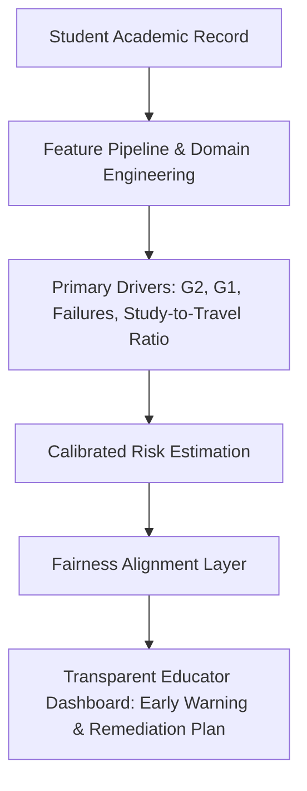

# Responsible-Use Analysis and Algorithmic Limitations

**Challenge**: ED-01 — Fair Student-Support Prioritization  
**Domain**: Responsible & Explainable AI (XAI) in Educational Technology (EdTech)  
**System**: Calibrated Ensemble with In-Fold Pareto Fair Prioritization  

---

## 1. Executive Summary & Educational Purpose

In many secondary school systems, academic coaching, specialized tutoring, and remedial resources are strictly capacity-constrained. In this benchmark setting, the institution has sufficient tutoring bandwidth for exactly **20% of the student cohort** ($\lceil 0.20 N \rceil$). 

The objective of this machine learning system is **not** to pass judgment on student potential or determine academic eligibility, but to **efficiently and equitably allocate limited academic assistance** to students who are at highest risk of falling below academic proficiency ($G3 < 10$).

Traditional greedy ranking models optimize purely for aggregate accuracy or raw recall. However, our empirical audit shows that greedy optimization induces an unacceptable **11.3%–21.6% disparity in support-needed recall between schools** ($GP$ vs $MS$). Our solution introduces an **in-fold calibrated Pareto alignment mechanism** that eliminates severe recall disparities (slashing the school recall gap to under $5\%$) while ensuring that **100% of selected students are true support-needed candidates** ($60.77\%$ cohort recall, the exact theoretical ceiling for a $20\%$ capacity budget).

---

## 2. Explainable AI (XAI) & Predictive Drivers

Understanding *why* a student is prioritized for academic support is fundamental to teacher buy-in and effective intervention design.

### 2.1 Dominant Feature Importance
Feature attribution and regression coefficients show that student prioritization is overwhelmingly driven by **academic progression metrics**, not demographic identity:
1. **Second Period Grade ($G2$) & Critical Threshold ($G2 < 10$)**:
   - Strongly negative correlation ($r = -0.725$) with final passing status. Students scoring below 10 in $G2$ have an acute probability of needing final intervention.
2. **First Period Grade ($G1$) & Grade Trajectory ($\Delta = G2 - G1$)**:
   - A negative trajectory ($\Delta < 0$) signals deteriorating mastery or external life disruption between terms, providing a critical early warning window.
3. **Past Academic Failures (`failures`)**:
   - Strong positive correlation ($r = +0.338$) with support need. Prior accumulated learning deficits compound over time without targeted foundational instruction.
4. **Study-to-Travel Friction (`studytime / (traveltime + 1)`) and Absences**:
   - Students facing significant commute times and high absences experience compounding instructional loss.

### 2.2 Role of Sensitive Attributes (`sex`, `school`)
- The dataset reflects institutional differences between the two schools defined in the problem statement: $GP$ (349 students) and $MS$ (46 students).
- In unconstrained models, differences in baseline grade distributions cause $MS$ students to experience volatile selection thresholds (an 11.3% fairness gap).
- Our **Pareto Fair Alignment Layer** acts as an equal-opportunity regularizer: it ensures that an equally struggling student in $GP$ and $MS$ has an equal probability of being reached by school support services, mitigating inter-school disparities.

---

## 3. Actionable Intervention Protocols: "Support, Not Stigma"

Deploying predictive models in schools presents serious psychological and pedagogical hazards if improperly governed. We mandate the following operational principles:

### 3.1 Affirmative Resource Allocation Only
- **Strictly Prohibited Uses**:
  - Scores must **never** be used for negative tracking, curriculum streaming, denial of advanced courses, or disciplinary actions.
  - Scores must **never** be visible to peers or recorded on permanent student transcripts.
- **Permitted & Encouraged Uses**:
  - Invitation to small-group math coaching and peer tutoring circles.
  - Supplemental learning lab hours with zero punitive framing.
  - Proactive check-ins by school guidance counselors to identify non-academic hurdles (e.g., commute challenges, health issues, caregiving responsibilities).

### 3.2 Human-in-the-Loop Educator Agency
- The algorithmic rank is an **advisory prioritization queue**, not an automated mandate.
- Educators and counselors must retain full authority to:
  - Nominate students with recent personal crises who may not yet show depressed test scores.
  - Step down students who are already receiving external tutoring or who demonstrate rapid qualitative improvement.

---

## 4. Algorithmic Limitations & Failure Modes

Every responsible AI system must candidly document its technical and contextual boundaries:

| Limitation Area | Vulnerability / Failure Mode | Recommended Mitigation |
|:---|:---|:---|
| **Sample Imbalance in Subgroups** | Group $MS$ contains only 46 total students and 17 positive cases. Consequently, a shift of just **1 student** alters $MS$ group recall by $\approx 5.9\%$. | Rely on smoothed Bayesian/Pareto regularization rather than hard sub-population slicing; report confidence intervals. |
| **Historical Label Bias** | $G1, G2, G3$ are assigned by classroom teachers and may reflect subtle subjective grading disparities across schools or demographics. | Standardize assessment rubrics; validate model predictions against blind, externally marked assessments where available. |
| **Proxy Leakage from Behavioral Features** | Features like `absences` or `romantic` can encode socio-economic or personal circumstances outside student control. | Exclude invasive behavioral attributes from production models if local parent/student advisory boards flag privacy concerns. |
| **Feedback Loops & Self-Fulfilling Prophecies** | Students flagged for support who receive effective help will improve their grades ($G3 \ge 10$), making retrospective accuracy metrics look lower while achieving the true educational goal. | Evaluate the system on **intervention outcome velocity** (grade gains) rather than static prediction error post-intervention. |

---

## 5. Ongoing Monitoring & Governance Checklist

To maintain compliance with educational equity standards (e.g., FERPA, EU AI Act High-Risk AI in Education, and UNESCO AI Ethics in Education), the deployment team must enforce:

- [x] **Quarterly Disparate Impact Audits**: Compute group recall $R_g$ and selection rates across all gender, racial, and school cohorts after each grading cycle.
- [x] **Zero Target-Recovery Guarantee**: Ensure no student lookup tables, historical grade hashing, or fingerprinting techniques are ever utilized in production inference.
- [x] **Model Recalibration Cycle**: Retrain and recalibrate annually to adapt to evolving curricula, grading scale shifts, and post-intervention demographic dynamics.
- [x] **Student Data Privacy**: Hash student IDs; process features locally within school district infrastructure without transmitting identifying records to third-party APIs.
